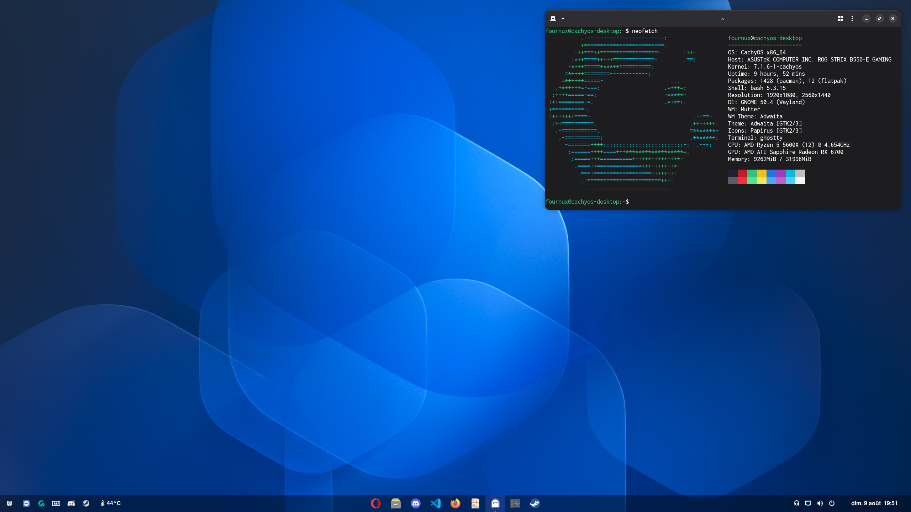

<h1 align="center">CachyOS Setup</h1>

  <strong>
    My personal CachyOS setup with GNOME, automated with Ansible.
  </strong>

  
  
  

  

## Software

| Purpose                | Choice                                                                                                                                                                                                     |
| ---------------------- | ---------------------------------------------------------------------------------------------------------------------------------------------------------------------------------------------------------- |
| Terminal               | [**Ghostty**](https://github.com/ghostty-org/ghostty)                                                                                                                                                      |
| System monitoring      | [**Mission Center**](https://gitlab.com/mission-center-devs/mission-center)                                                                                                                                |
| DNS provider           | [**NextDNS**](https://nextdns.io/) via [**systemd-resolved**](https://github.com/systemd/systemd) — routes all system DNS queries over DNS-over-TLS with DNSSEC validation                                 |
| Audio player           | [**Gapless**](https://gitlab.gnome.org/neithern/g4music)                                                                                                                                                   |
| Video player           | [**mpv**](https://github.com/mpv-player/mpv) — custom [**MVUtensils**](https://github.com/myrsloik/mvutensils) motion interpolation for TV-style motion smoothing, toggled with `Shift+I`                  |
| Web browser            | [**Firefox**](https://github.com/mozilla-firefox/firefox)                                                                                                                                                  |
| Code editor            | [**Visual Studio Code**](https://github.com/microsoft/vscode)                                                                                                                                              |
| AI coding agents       | [**Codex CLI**](https://github.com/openai/codex), [**Claude Code**](https://code.claude.com/docs/en/overview), and [**Antigravity CLI**](https://antigravity.google) |
| Claude desktop app     | [**claude-desktop**](https://aur.archlinux.org/packages/claude-desktop) (AUR) |
| Netflix browser        | **Opera** — the only browser that gives me 1080p Netflix playback on Linux                                                                                                                                 |
| Proton version manager | [**ProtonPlus**](https://github.com/Vysp3r/ProtonPlus) — manages [Proton-GE](https://github.com/GloriousEggroll/proton-ge-custom) and [Proton-CachyOS](https://github.com/CachyOS/proton-cachyos) versions |
| System upgrades        | [**Topgrade**](https://github.com/topgrade-rs/topgrade) — centralizes upgrades across packages, tools, and runtimes; replaces the preinstalled `cachy-update` and Shelly, which are removed |
| PDF toolkit            | [**Stirling PDF**](https://github.com/Stirling-Tools/Stirling-PDF)                                                                                                                                         |

Ankama Launcher is installed from the AUR. Run
`./bootstrap.sh run --tags ankama` to apply this role on its own.

## AI coding agents

Codex, Claude Code, and Antigravity share the skills in `~/.agents/skills`, the
global instructions in `roles/ai_agents/files/agents/AGENTS.md`, Serena, Context7,
and the `i-have-adhd` plugin. Claude Code uses the native installer with automatic
updates and signs in with your Claude subscription. Run `claude` after setup to
sign in. Its `~/.claude/skills` directory contains individual links to the configured
shared skills. Ansible preserves existing user state when configuring MCP servers
in `~/.claude.json`. The `ai_agents` role installs its own Bun, uv, and rustup
dependencies, so `./bootstrap.sh run --tags claude` works on its own.

## Machine profiles

The shared playbook configures both machines. Each machine is an inventory host
named after its hostname, in the `desktop` or `laptop` group, and
`./bootstrap.sh` limits the play to the host matching `uname -n`. Machine-specific
values live in `group_vars/desktop/` and `group_vars/laptop/`, so
hardware-specific packages and services do not leak between them.

| Group     | Hostname          | Additional configuration                                          |
| --------- | ----------------- | ----------------------------------------------------------------- |
| `desktop` | `cachyos-desktop` | [**Wootility**](https://github.com/WootingKb/wootility-linux), Wake-on-LAN, and no automatic suspend |
| `laptop`  | `cachyos-laptop`  | `asusctl`, `supergfxctl`, `rog-control-center`, and `solaar`; `supergfxd` is enabled and started                                        |

## GNOME extensions

- [**Dash to Panel**](https://github.com/home-sweet-gnome/dash-to-panel) — provides a horizontal taskbar similar to Windows.
- [**Vitals**](https://github.com/corecoding/Vitals) — displays and monitors system temperatures.

## Manual assets

- `show-elgato-output.sh` is a validated standalone helper. Run `./show-elgato-output.sh --help`; its default capture device is machine-specific and can be overridden with `--video-device` and `--sound-device`.

## Appearance

- **Icon theme:** [**Papirus**](https://github.com/PapirusDevelopmentTeam/papirus-icon-theme)
- **Default system font:** [**FreeSans**](https://www.gnu.org/software/freefont/) 12
- **Terminal font:** [**Inconsolata Medium**](https://github.com/googlefonts/Inconsolata) 14

## Ansible Vault password

> `vault_password_file` is intentionally omitted from `ansible.cfg`; `bootstrap.sh` supplies it only for `run` and `check`, so lint and CI do not depend on a local secret.
